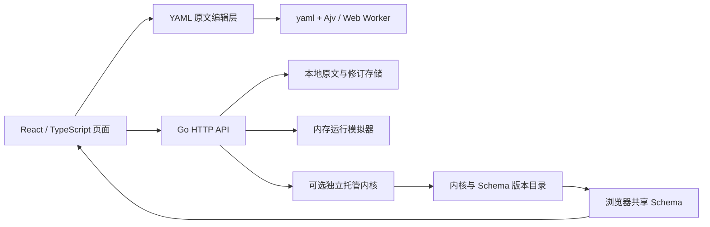

# 架构记录：本地页面阶段

状态：本地配置工作台，Linux 可选托管内核，2026-10-27；已完成首个路由器目标的只读探测。

## 已确定的边界

1. 原始 YAML 文本是单一配置源。界面模型由解析得到，不能反向全量序列化覆盖用户文档。
2. 表单针对已有源码范围修改。无法确定注释或共享结构归属时拒绝表单操作，交给源码编辑器。
3. 草稿、已应用配置、运行时状态分离。保存不会修改运行状态；模拟应用后运行模式按 YAML 重置。
4. 保存使用内容哈希作为修订号。`If-Match` 不符返回 409，避免多个页面静默覆盖。
5. 默认模拟器只做页面流程验证。订阅只编辑原生 provider 配置，不下载或解析订阅。Linux 托管模式可从工作台真实应用配置，版本更新和配置应用共用任务锁与确认后提交机制；路由器网络尚未接入。

## 技术选型

| 层 | 选型 | 作用 |
| --- | --- | --- |
| 页面 | React 19、TypeScript、Vite 8 | 本地热更新、组件交互、类型检查 |
| 样式 | CSS、Lucide SVG 图标 | 页面迭代直接，使用系统字体，无远程字体依赖 |
| 编辑器 | Monaco、monaco-yaml；CodeMirror 6、MergeView | 源码智能提示、编辑器内撤销；只读与差异比较 |
| 文档 | yaml 2.9.1 | AST 和源码范围读取、局部写入 |
| 前端校验 | Ajv 8、Web Worker | 不补默认值、不转换类型、不删除未知字段 |
| 本地服务 | Go 1.27、标准库 net/http | 文件持久化、修订冲突、静态检查、模拟运行 |
| Go YAML | go.yaml.in/yaml/v3 | 服务端静态解析，不用于重写用户原文 |
| 测试 | Vitest、Go testing | 范围外字节保留、引用、冲突与状态隔离 |

当前没有 SQLite、UCI 镜像、云端同步或第三方转换服务。订阅使用原生 `proxy-providers`，自建节点使用 `proxies`，代理组通过 `use` 和 `proxies` 同时引用。订阅下载、解析、更新和缓存由 Mihomo 负责，管理器不实现另一套订阅服务。

## 内核与资源页面

GEO 配置沿用原始 YAML 和现有草稿保存接口，不增加独立配置存储或下载服务：

| 页面设置 | 原生 YAML 字段 |
| --- | --- |
| GEOIP 数据格式 | `geodata-mode`，false 为 MMDB，true 为 DAT |
| DAT 加载方式 | `geodata-loader` |
| GEO 自动更新及间隔 | `geo-auto-update`、`geo-update-interval`（小时） |
| 四类数据来源 | `geox-url.geosite`、`geoip`、`mmdb`、`asn` |

未指定字段仅展示默认值，不自动写入。表单确认后局部修改草稿；统一保存预览列出配置块和增删行数，以及 YAML 差异，确认保存后才持久化。恢复默认移除字段；切换数据格式不会移除另一种格式的来源。包含共享锚点、合并继承或无法保留注释的删除操作退回源码编辑。

托管内核显式启用后可以真实更新和回退，健康检查成功才提交内核与 Schema 版本。默认关闭；资源文件状态与手动下载仍未接入。provider 保持各自更新设置，由 Mihomo 执行。详见 [内核更新与 Schema](core-update.md)。

## 规则集可视化编辑

`rule-providers` 沿用原始 YAML；HTTP、file、inline 三类来源在分流规则页编辑，无额外配置存储。HTTP 更新间隔为秒，GEO 更新间隔为小时。表单保留未知字段和省略的默认值，检查 MRS 行为限制、来源地址、间隔与重复路径。

RULE-SET 创建时通过已有规则集选择器确定引用，保持路由规则顺序。普通 rules/sub-rules 引用可随改名局部改写；复杂规则、DNS/TUN 引用及共享 YAML 结构拒绝自动重写。删除前检查引用。更新和删除均进入既有草稿预览，中文摘要与 YAML 差异使用同一前后文本。

规则编辑接口不会请求外部规则 URL、读取规则文件或启动更新任务。Go 草稿存储接口保持原样；托管内核仅处理其独立配置文件中指定的资源。

## 本地 API

### 代理组成员混排

代理组提供“跟随来源”和“自定义混排”。后者仍使用原生 `proxies` / `use`，通过 Mihomo 的分段 `filter` 设置跨来源优先顺序，不提取、转换或复制订阅节点。原有包含筛选和排除条件保留；前端保存前调用只读预览接口，校验实际成员顺序与页面一致。

顺序以节点名称写入该代理组的 `x-manager-order` 扩展字段，与原生 `filter` 一起进入现有草稿、块摘要和 YAML 差异。已记录名称不受订阅重排影响，暂时缺失的名称保留位置，新名称追加到末尾；未确认排序的新名称之间跟随来源顺序。自建节点通过管理器改名时同步更新引用和排序，订阅改名按新节点处理。跨来源同名节点会阻止自定义排序，避免选错节点。

混排不调用运行时切换接口。当前所选名称仍存在时，由内核的选择状态和 `profile.store-selected` 保留选择；节点被删除、改名或使用 fallback 等自动选路组时遵循内核行为。排序不自动开启或关闭选择缓存。恢复“跟随来源”还原用户原本的 `filter`；若用户手改了生成的表达式，表单要求先解决冲突，不静默覆盖。

HTTP/file 订阅列表只读取与已应用定义一致的内核名称/类型，离线保留已有顺序；不额外请求订阅链接。默认本地模拟可使用不带覆盖/过滤设置的 inline 示例，完整协议与订阅行为以真实内核为准。拖动由共享 `OrderedList` 和 dnd-kit 提供，另有上下箭头和键盘操作。

验证命令：`npm test`、`npm run build`、`node scripts/go.mjs test ./...`；可选 `node scripts/check-group-order.mjs <官方 Mihomo 可执行文件绝对路径>` 对比真实内核。该脚本仅启动回环 API 和测试订阅，关闭代理端口、DNS 与 TUN，结束后清理进程和临时配置。

| 方法和路径 | 语义 |
| --- | --- |
| `GET /api/health` | 服务状态，`simulation` 区分默认模拟与托管模式 |
| `GET /api/state` | 草稿、已应用文本、版本号、修订列表和模拟状态 |
| `GET /api/status` | 轻量版本与运行状态；不重复传输 YAML 和历史 |
| `GET /api/core/providers` | 已应用订阅的节点数量、更新时间、加载状态和节点名称/协议类型；不返回链接、地址或凭据 |
| `POST /api/group-order/preview` | 用内核同类正则引擎预览成员和顺序，不下载订阅、不修改配置或当前选择 |
| `POST /api/validate` | Go YAML 和有限字段/引用检查，`coreValidated: false` |
| `PUT /api/draft` | 携带 `If-Match` 保存原文；允许保存语法错误的草稿 |
| `POST /api/apply` | 模拟模式同步应用；托管模式按草稿/内核/已应用版本异步校验、切换及失败恢复 |
| `PATCH /api/runtime` | 模拟模式临时修改；托管模式尚未接入，明确拒绝 |

请求上限 2 MB；写请求有来源限制。所有服务只绑定回环地址。这些限制服务于本地开发，不构成未来路由器或公网场景的完整鉴权方案。

## 当前明确限制

真实配置应用的存储、资源隔离和中断恢复见 [配置事务](config-apply.md)。已应用原文来自受哈希校验的 YAML 版本文件；只有运行检查通过才在内核状态文件中原子提交该文件的引用。旧模拟状态不作为真实内核的配置来源。

- 编辑器的撤销历史属于当前挂载的编辑器，跨页面的历史恢复使用修订记录。
- 锚点或合并继承对象不提供表单改写。HTTP provider 和普通组成员可在表单修改，复杂规则、带注释的结构修改和其他 provider 类型在源码中完成。
- Go 和浏览器 YAML 解析器并非完全同一语义；托管模式应用时以真实内核 `mihomo -t` 为最终校验。
- 工作台不加载订阅节点，也不提供订阅更新或节点缓存。托管内核更新不提供系统代理或路由修改。
- 托管模式保存完整 YAML 历史，并隔离复制和恢复 Mihomo 资源目录；管理器不直接解释或编辑 cache.db。
- 本地文件替换不构成路由器上线所需的掉电恢复与网络回滚机制。

## 后续路由器阶段的预留方向

未来接入时，应在服务层新增运行控制接口，将模拟器替换为单独的内核控制适配器。前端仍通过管理 API 操作，不能直接获得内核管理密钥。订阅节点与状态从 Mihomo 的 provider API 读取，更新操作也交给内核。

路由器阶段的权限边界继续拆为普通管理服务、范围受限的特权 agent、由 procd 管理的 Mihomo。网络接管、DNS、防火墙、升级和回滚由 agent/平台适配负责。目前已接通显式代理场景的真实 `mihomo -t`、暂存版本、提交确认、失败恢复和健康检查，尚未接入路由器网络操作。

首个适配目标和实施顺序已在 [路由器适配前复查](router-readiness-20261027.md) 中确定；平台 agent、procd 适配和网络事务尚未实现。
